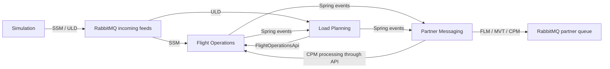

# Air Freight Operations

Spring Boot backend for flight schedules, delays, actual movement times, cargo bookings, load planning, configurable policy and partner messages. A separate simulator submits schedules and bookings through the same RabbitMQ feeds as external systems.

## Frameworks and versions

The Gradle wrapper, dependency BOMs and Docker Compose define the versions below. Spring Boot and Spring Modulith manage the other Java dependencies.

| Component | Version |
| --- | --- |
| Java / Gradle (Kotlin DSL) | 25 / 9.5.1 |
| Spring Boot / Spring Framework | 4.1.1 / 7.0.9 |
| Spring Modulith | 2.1.1 |
| Spring Security | 7.1.1 |
| Spring Data JPA / Hibernate ORM | 4.1.1 / 7.4.5.Final |
| Spring AMQP / RabbitMQ Java client | 4.1.1 / 5.31.0 |
| Jackson | 3.1.5 |
| PostgreSQL server / JDBC driver | 18.6-alpine / 42.7.13 |
| RabbitMQ server | 4.3.6-management |
| H2 (tests) | 2.4.240 |
| JUnit Jupiter / Mockito | 6.0.3 / 5.23.0 |
| AssertJ / Awaitility | 3.27.7 / 4.3.0 |
| Keycloak / MySQL | 26.7.4 / 9.7.2 |

## Run locally

Install Java 25 and start Docker Desktop. Import `build.gradle.kts` in IntelliJ, select Java 25 for the project SDK and Gradle JVM, and reload Gradle.

Start the infrastructure:

```sh
docker compose up -d app_postgres app_rabbitmq idp_mysql idp_keycloak
```

For a new Keycloak installation, follow the manual setup in [authentication.http](src/test/http/authentication.http) before making authenticated requests. Create the `airfreight` realm, the three roles and users, the confidential `airfreight-api` client for HTTP testing, and the public `airfreight-web` client for browser login. Configure the `airfreight-api` audience as described there. Keycloak state is retained in MySQL; there is no automatic realm import.

Run the backend with local flight fixtures and the simulator:

```powershell
# Windows PowerShell
.\gradlew.bat bootRun --args="--spring.profiles.active=local,simulation"
```

```sh
# Linux / macOS
sh ./gradlew bootRun --args='--spring.profiles.active=local,simulation'
```

| Service | Local address |
| --- | --- |
| Backend API | `http://localhost:8080` |
| PostgreSQL | `localhost:5443` |
| RabbitMQ AMQP | `localhost:5672` |
| RabbitMQ management | `http://localhost:15672` |
| Keycloak | `http://localhost:8380` |
| Keycloak's MySQL | `localhost:3307` |

Keycloak maps host port `8380` to container port `8080`. This avoids a Windows port reservation previously encountered on `8180`. If Docker reports a forbidden host port, check `netsh interface ipv4 show excludedportrange protocol=tcp` as well as listening processes. Changing the Keycloak host port also requires updating the issuer URI and HTTP client environment.

The `local` profile only enables [data.sql](src/main/resources/data.sql). It adds today's UTC `HJ9010` and `HJ9011` and yesterday's `HJ9001`, `HJ9002` and `HJ9003` fixtures, preserving existing rows. Authentication always uses Keycloak; this profile creates no mock accounts. `HJ9002` has a seeded final-load flag for the flight HTTP examples, not a real CPM history.

The simulator requires `simulation` and is excluded whenever `prod` or `production` is active. Omit `local` to avoid sample data and omit `simulation` to disable simulation. The simulator consists of API endpoints only; no simulator UI is required.

### Create a load-planning demo flight

The `data.sql` flights are persistence snapshots and do not create Load Planning or partner-message state. To create a fresh flight through the real SSM/ULD workflow, keep the backend running with `local,simulation` and follow [simulation.http](src/test/http/simulation.http): submit the schedule as a flight planner, wait for its load, then submit cargo as a load planner. Continue with [loads.http](src/test/http/loads.http) to place cargo and finalise the load. No PowerShell setup script is required.

[schema-creation.sql](init-scripts/sql/schema-creation.sql) creates the module schemas, tables and reference aircraft layout. Docker mounts `./init-scripts/sql` at `/docker-entrypoint-initdb.d` inside PostgreSQL. PostgreSQL runs the SQL files there when it initializes an empty data directory. Restarting an existing database does not run them again.

Partner messages use their existing `message_id` UUID as the primary key. The former generated `sequence` column is removed from the fresh-database schema; an existing database is not upgraded automatically.

Flight Operations owns the `flightoperations` schema, Load Planning owns `loadplanning`, and Partner Messaging owns `partnermessaging`. Spring Modulith's publication registry uses `events`. JPA entities declare their owning schema, and `spring.jpa.hibernate.ddl-auto=validate` checks the prepared database. Normal application startup does not create tables. The `local` profile only inserts sample data into existing tables.

Connection overrides supported by [application.properties](src/main/resources/application.properties) are `DATABASE_URL`, `DATABASE_USERNAME`, `DATABASE_PASSWORD`, `RABBITMQ_HOST`, `RABBITMQ_PORT`, `RABBITMQ_USERNAME`, `RABBITMQ_PASSWORD` and `KEYCLOAK_ISSUER_URI`.

## Authentication and permissions

The API is a stateless OAuth2 resource server. Send `Authorization: Bearer <access-token>`. The backend validates the token's issuer and `airfreight-api` audience and maps Keycloak realm roles to Spring authorities. Session cookies and CSRF tokens are not used by this API.

| Role | Permissions |
| --- | --- |
| `flight-planner` | Read flight/load/policy data; change delays and record actual times; submit simulated schedules when enabled |
| `load-planner` | Read flight/load/policy data; place, move and remove placements, check/finalise loads; submit simulated cargo when enabled |
| `admin` | Read flight/load/policy data and change flight/load policy settings |

Admin does not include planner permissions. The browser client uses Authorization Code with PKCE. The HTTP examples use the configured confidential client and direct access grants. Keep its generated client secret in the ignored `src/test/http/http-client.private.env.json`; follow the placeholder structure in `authentication.http`.

## API and time contract

[docs/openapi.yaml](docs/openapi.yaml) describes all current routes, bodies, responses and role requirements.

| Area | Routes |
| --- | --- |
| Flight queries and changes | `/api/flights` and `/api/flights/{number}/{date}/{airport}/...` |
| Load queries, placement and finalisation | `/api/loads/{number}/{date}/{airport}/...` |
| Policy | `/api/flights/policy` and `/api/loads/policy` |
| Simulation | `/api/simulation/schedules` and `/api/simulation/cargo-bookings` |

API date-times are UTC `LocalDateTime` strings without `Z` or an offset, for example `2026-10-22T10:00:00`. Identity dates are UTC scheduled departure dates. Schedule times are also UTC. The frontend must explicitly interpret this contract and convert display/input to `Europe/Brussels`; see [TODO.md](TODO.md#utc-and-brussels-local-time).

## Tests and HTTP examples

Automated tests cover the assignment's four required areas: time and delay rules, SSM processing and FLM publishing, IATA date derivation, and load checks. The SSM integration tests use H2 and mocked Rabbit templates. The test profile initializes H2 from the same schema-creation script, which Gradle includes as a test resource. Docker is unnecessary for these tests:

```powershell
.\gradlew.bat test
.\gradlew.bat build
```

On Linux/macOS, use `sh ./gradlew test` or `sh ./gradlew build`. The build writes the runnable JAR to `build/libs/`.

For live HTTP checks, start the services and backend above, open [src/test/http/](src/test/http) in IntelliJ and select the indicated environment:

1. Run [authentication.http](src/test/http/authentication.http) to obtain a bearer token. Repeat after switching between `planner` and `loader`, or when the token expires.
2. As `planner`, run [flights.http](src/test/http/flights.http) for a flight query, delay changes, departure and arrival.
3. Follow [simulation.http](src/test/http/simulation.http): submit the schedule as `planner`, wait until its load can be read, then authenticate as `loader` and submit cargo.
4. Wait for both ULDs, then run [loads.http](src/test/http/loads.http) as `loader` for placement, checks and finalisation. Repeat its final request until CPM processing is visible in Flight Operations.

These four HTTP files contain 17 requests for the main successful workflows. Separate policy and error suites and additional search/placement examples have been removed to keep testing within the requested minimum scope.

A simulation response of `202` contains message IDs; it does not mean the flights or bookings have finished processing. Flight departure/arrival fixtures and finalisation are one-time actions; restarting preserves those changes. Use fresh test data to repeat the whole workflow.


Those results do not close the deferred partner-outage guarantee or live retention-expiry verification. Remaining work is recorded in [TODO.md](TODO.md).

## Events and RabbitMQ



| Exchange | Routing keys | Queues |
| --- | --- | --- |
| `airfreight.feeds` | `ssm`, `uld` | `airfreight.ssm`, `airfreight.uld` |
| `airfreight.feeds.dlx` | `ssm`, `uld` | `airfreight.ssm.dlq`, `airfreight.uld.dlq` |
| `airfreight.partner-messages` | `flm`, `cpm`, `mvt.ed`, `mvt.ea`, `mvt.ad`, `mvt.aa` | `airfreight.partners` |

The simulator and feed listeners share `common.messages.SsmMessage` and `UldMessage`. Listeners translate these records into module-owned commands. Each consumer stores successful message IDs in the same transaction as its changes; duplicates are logged and ignored. Both feed listeners start automatically during normal operation.

Incoming failures retry three times, then are rejected into the appropriate dead-letter queue. Our simulator sets the RabbitMQ message ID; Spring's exhausted-retry warning includes it and the failure. Malformed and rule-breaking messages were verified in the live checks. The exact external SSM/ULD JSON schema still needs confirmation against an authoritative lecturer schema.

Spring Modulith records transactional event publications. Failed publications are resubmitted every 30 seconds, and outstanding publications are republished on restart. Partner messages are stored before publication; retries reuse the stored body, ID and format metadata. Creation is deduplicated by source event and message kind. The current publisher has no broker-confirmation handling, so a successful template call is not proof of broker acceptance or once-only delivery after an outage.

## Extending the backend

See [docs/EXTENSION.md](docs/EXTENSION.md) for adding load checks, floor plans, position kinds and MVT types with their own validation. It also identifies the remaining main-deck adapter assumptions and the current single-timestamp MVT contract. [COURSE_ALIGNMENT.md](COURSE_ALIGNMENT.md) explains the course patterns and project-specific adaptations.
