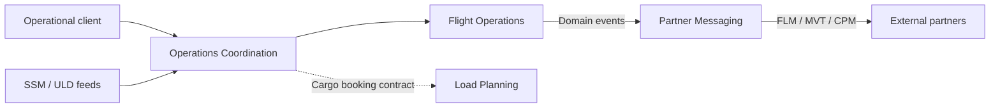

# Air Freight Operations

A backend for coordinating cargo flights: schedules, departure and arrival delays, actual movement times, operational settings and partner messages. Load Planning currently exposes its public booking contract.



## Frameworks and versions

Versions below come from the Gradle wrapper, resolved dependency graph and Docker Compose configuration. Spring Boot and Spring Modulith BOMs manage dependency versions.

| Component | Version |
| --- | --- |
| Java / Gradle (Kotlin DSL) | 25 / 9.5.1 |
| Spring Boot / Spring Framework | 4.1.1 / 7.0.9 |
| Spring Modulith | 2.1.1 |
| Spring Security | 7.1.1 |
| Spring Data JPA / Hibernate ORM | 4.1.1 / 7.4.5.Final |
| Spring AMQP / RabbitMQ Java client | 4.1.1 / 5.31.0 |
| Jackson | 3.1.5 |
| PostgreSQL server / JDBC driver | 18.6-alpine / 42.7.13 |
| RabbitMQ server | 4.3.6-management |
| H2 (tests) | 2.4.240 |
| JUnit Jupiter / Mockito | 6.0.3 / 5.23.0 |
| AssertJ / Awaitility | 3.27.7 / 4.3.0 |
| Keycloak / MySQL (prepared, unused by application) | 26.7.4 / 9.7.2 |

## Run

Install Java 25 and start Docker Desktop. In IntelliJ, import `build.gradle.kts`, select Java 25 for the project SDK and Gradle JVM, and reload Gradle. The wrapper supplies Gradle.

### Windows (PowerShell)

```powershell
docker compose up -d app_postgres app_rabbitmq
.\gradlew.bat bootRun --args="--spring.profiles.active=local"
```

### Unix (Linux / macOS)

```sh
docker compose up -d app_postgres app_rabbitmq
sh ./gradlew bootRun --args='--spring.profiles.active=local'
```

The API runs at `http://localhost:8080`; PostgreSQL uses port `5443`, RabbitMQ `5672`, and RabbitMQ management `15672`.

The `local` profile enables sample data and public mock accounts. All use password `local123`:

| Account | Role |
| --- | --- |
| `planner` | `flight-planner`: read flights/policy and change flights |
| `loader` | `load-planner`: read flights/policy |
| `admin` | `admin`: read flights/policy and update policy |

Form login uses a session cookie; mutations require a CSRF token. Admin does not imply planner rights. Without `local`, sample data and mock accounts are disabled; the user store is empty. Keycloak authentication is not connected yet.

[schema.sql](src/main/resources/schema.sql) creates missing tables before Hibernate validates them. [data.sql](src/main/resources/data.sql) adds yesterday's UTC flights: `HJ9001` for delays and missing-load errors, `HJ9002` ready for departure/arrival, and landed `HJ9003`. All depart from `BRU`. Existing rows are preserved on restart. HJ9002's final-load flag is a fixture; seeding does not publish events or create partner-message history. Restart after the UTC date changes to seed the new date.

Connection settings in [application.properties](src/main/resources/application.properties) accept `DATABASE_URL`, `DATABASE_USERNAME`, `DATABASE_PASSWORD`, `RABBITMQ_HOST`, `RABBITMQ_PORT`, `RABBITMQ_USERNAME` and `RABBITMQ_PASSWORD` overrides.

## Tests

Tests use isolated H2 databases, a mocked broker and test security sessions. Docker is unnecessary for the automated tests.

### Windows (PowerShell)

```powershell
.\gradlew.bat test
.\gradlew.bat build
```

### Unix (Linux / macOS)

```sh
sh ./gradlew test
sh ./gradlew build
```

`build` includes tests and writes the runnable JAR to `build/libs/`.

For manual API checks, open [src/test/http/](src/test/http) in IntelliJ and select an environment:

1. Run [authentication.http](src/test/http/authentication.http) in order to capture the session and fresh CSRF token. Repeat when switching accounts.
2. With `planner`, run [flights.http](src/test/http/flights.http) and [errors.http](src/test/http/errors.http).
3. With `admin`, run [policy.http](src/test/http/policy.http); its last request restores the original settings.

Flight departure/arrival can run once per daily fixture; restarting preserves recorded times. Delay requests can be repeated after their matching deletions.

## API documentation

See the [OpenAPI specification](docs/openapi.yaml) for paths, request/response schemas, roles, session/CSRF authentication and error responses. It documents the current API and can be imported into an OpenAPI viewer. Dates and times use UTC `LocalDateTime` strings without an offset suffix.

## Source structure

```text
src/main/java/be/kdg/airfreight/
  AirFreightApplication.java
  common/                    Shared values and events/
  config/                    Application scheduling and security
  flightoperations/          Flights, departure, arrival and delays
  loadplanning/              Public cargo booking contract
  operationscoordination/    HTTP requests, feeds and policy settings
  partnermessaging/          Partner message creation and delivery
```

Each module uses only the directories it needs:

```text
<module>/
  adapter/
    config/                  Module-specific Rabbit topology
    in/
      api/                   Public module API implementations
      rest/                  Controllers, HTTP records and exception handling
      listeners/             Incoming feeds and application events
      scheduling/            Scheduled triggers
    out/
      api/                   Calls to other public module APIs
      events/                Event publishers
      formatting/            JSON and telegram formatting
      persistence/           Persistence adapters and mapping
        entity/              JPA entities
        repository/          Spring Data repositories
      rabbit/                Rabbit publishers
  core/                      One service implementation per use case
  domain/                    Aggregates, entities and value objects
  events/                    Module-owned internal events
  port/
    in/
      usecase/               Single-operation input interfaces
      command/               Immutable input commands
    out/                     Interfaces required by use cases
```

Adapters translate external input/output; use cases coordinate work; domain classes enforce business rules. Operations Coordination has no `domain/` package: it routes requests and persists shared settings. Shared events live in `common/events`; `common/package-info.java` exposes that shared package to Spring Modulith. Test sources mirror the application packages under `src/test/java`.

## Events, delivery and feeds

Spring Modulith persists transactional events and retries failed listeners every 30 seconds. Partner Messaging stores FLM/CPM JSON and MVT telegrams, then publishes through RabbitMQ. Retries retain the message ID; receivers must handle duplicate delivery.

| Exchange | Routing keys | Queue |
| --- | --- | --- |
| `airfreight.feeds` | `ssm`, `uld` | `airfreight.ssm`, `airfreight.uld` respectively |
| `airfreight.partner-messages` | `flm`, `cpm`, `mvt.ed`, `mvt.ea`, `mvt.ad`, `mvt.aa` | `airfreight.partners` |

Feed failures retry and then enter `.dlq` queues. SSM/ULD field mappings remain provisional. Cargo consumption is disabled until Load Planning is implemented (`airfreight.feeds.cargo.enabled`).
